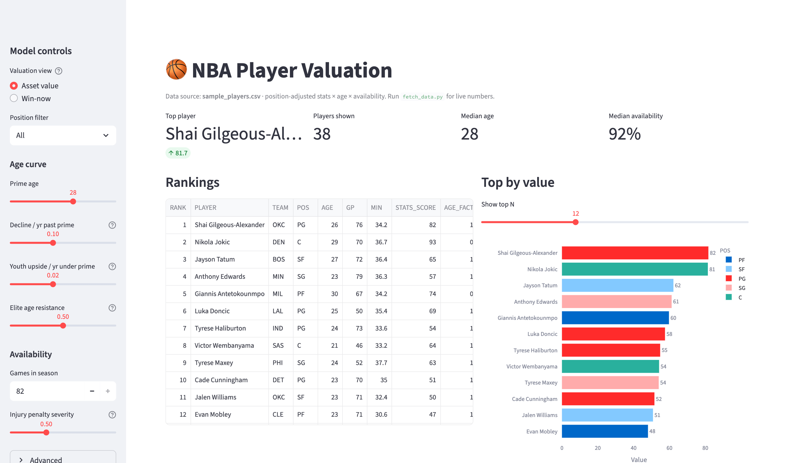
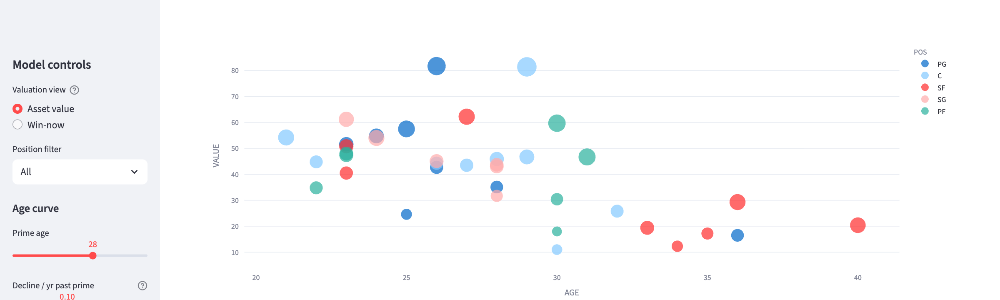
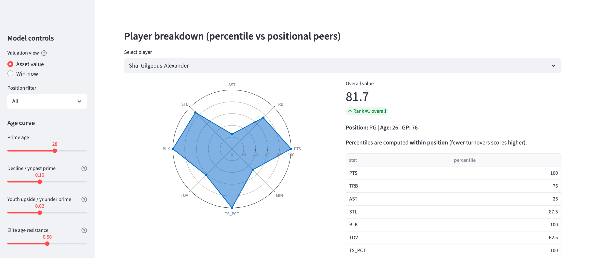

# 🏀 NBA Player Valuation

**How much is an NBA player really worth? This model rates every player on production, age and fitness, and turns every assumption into a slider so you can see how the ranking changes.**

Python · pandas · NumPy · Streamlit · Plotly · `nba_api` · The pricing engine behind [Agora](https://github.com/Mustafa-OS/agora-mvp)



## At a glance

- 🧮 **One transparent formula:** `VALUE = STATS × AGE × AVAILABILITY`. No black box: every weight and curve is a live control.
- ⚖️ **Fair comparisons:** each stat is judged against players in the **same position**, so a centre's assists are compared with other centres'.
- 🧓 **Smart ageing:** value declines after a player's prime, **unless they're still producing at an elite level**. It rewards sustained greatness, not reputation.
- 🩹 **Injury-aware without double counting:** missed games reduce value, but softly (square root), because per-game stats already ignore games not played.
- 🔌 **Runs out of the box** on 38 real players, or pulls live league-wide stats from stats.nba.com.

## The formula

```
VALUE = STATS_SCORE × AGE_FACTOR × AVAIL_FACTOR      ("asset" view: worth going forward)
VALUE = STATS_SCORE × AVAIL_FACTOR                   ("win-now" view: how good right now)
```

It multiplies rather than adds on purpose: production you can't count on, because the player is injured or past their prime, shouldn't earn partial credit.

## Example output

| RANK | PLAYER | POS | AGE | STATS_SCORE | AGE_FACTOR | AVAIL_FACTOR | VALUE |
|---|---|---|---|---|---|---|---|
| 1 | Shai Gilgeous-Alexander | PG | 26 | 81.6 | 1.04 | 0.96 | **81.7** |
| 2 | Nikola Jokic | C | 29 | 92.7 | 0.95 | 0.92 | **81.4** |
| 3 | Jayson Tatum | SF | 27 | 65.0 | 1.02 | 0.94 | **62.2** |
| 4 | Anthony Edwards | SG | 23 | 56.7 | 1.10 | 0.98 | **61.2** |
| 5 | Giannis Antetokounmpo | PF | 30 | 74.4 | 0.89 | 0.90 | **59.7** |

The factors do real work. Jokic has clearly the best stat line (92.7), but on **asset value** Gilgeous-Alexander edges ahead on age runway; switch to **win-now** and Jokic goes first (85.6 vs 78.5). A 21-year-old Wembanyama makes the asset top eight despite playing only 46 games; a 40-year-old LeBron still posts an above-average stats score (60.0) but an age factor of 0.37 prices in the remaining runway; Embiid's 19-game season collapses his availability factor to 0.48 and drops him to last.

## How it works

**1. Stats score — position-adjusted, gap-preserving.** Each stat is z-scored *within its position group* (a centre's assists are judged against other centres), blended 25% with the league-wide z-score to damp noise from small position groups. The weighted z-total is standardised and mapped linearly to 0–100 (50 = league average, ±15 per standard deviation) — unlike a percentile rank, this preserves gaps, so a generational season sits far above a merely good one. Default weights:

| PTS | AST | STL | BLK | TRB | TOV | TS% | MIN |
|---|---|---|---|---|---|---|---|
| 1.00 | 0.90 | 0.80 | 0.80 | 0.70 | −0.70 | 0.60 | 0.50 |

Turnovers count against; minutes count for, so a 36-minute engine outranks a 20-minute bench player with similar per-game numbers.

**2. Age factor — runway with elite resistance.** Full value at the prime age (default 28), a small capped upside bonus per year under it, exponential decline past it. The twist is **elite age resistance**: the decline rate is scaled down for players whose *current* production is elite — if a 36-year-old is still producing 2 SD above average, the collapse the age curve predicts hasn't materialised, so the full prior isn't applied. The protection fades automatically as the stats fade: it rewards sustained greatness, never reputation.

**3. Availability factor — a softened injury proxy.** `(games played / season length) ^ 0.5`. The square root matters: per-game stats already earn nothing for missed games, so a linear multiplier would double-punish. When prior-season games-played columns exist (the fetcher writes them), they are averaged in as a multi-season durability signal, with rookie seasons skipped rather than counted as zero.

### Architecture

```
fetch_data.py  ──(nba_api → stats.nba.com)──►  players.csv ─┐
                                                            ├──►  valuation.py  ──►  app.py
make_sample.py ──────────────────────►  sample_players.csv ─┘     (pure pandas/       (Streamlit +
                                        (bundled fallback)         NumPy scoring)      Plotly UI)
```

- `valuation.py` — the scoring engine: pure, importable functions with no UI dependency.
- `app.py` — Streamlit dashboard: ranking table, top-by-value chart, age-vs-value scatter, per-player percentile radar.
- `fetch_data.py` — pulls live league per-game stats and team-roster positions via [`nba_api`](https://github.com/swar/nba_api), computes true shooting, and writes `players.csv`, which the app picks up automatically over the sample.

Stack: Python, pandas, NumPy, Streamlit, Plotly.

## Screenshots

Age against value, coloured by position and sized by stats score — the shape of the age curve is visible in the data:



Per-player breakdown: raw-stat percentiles against positional peers (turnovers inverted), alongside overall value and rank:



## Run it

```bash
pip install -r requirements.txt
streamlit run app.py
```

Opens at `http://localhost:8501` and runs immediately on the bundled sample. For accurate live numbers:

```bash
python fetch_data.py --season 2024-25 --min-gp 15
```

Note: stats.nba.com sometimes rate-limits or blocks datacentre IPs — run the fetcher from a home connection and re-run if a call times out (results are only written on success).

## Beyond basketball

`valuation.py` is sport-agnostic by design: supply a CSV with `PLAYER, POS, AGE, GP` plus any sport's stat columns and a matching weights dict, and the position-adjustment, age and availability logic apply unchanged. Only the stat set and weights are basketball-specific.

## About

Personal project, summer 2026. It's the standalone valuation engine behind [Agora](https://github.com/Mustafa-OS/agora-mvp), a fan-trading platform where athlete prices move on news like draft declarations, injuries and contracts. Given a stat line, it produces a defensible value with every assumption visible.

---

<sub>Built by <b>Mustafa Suleman</b>, MEng Design Engineering, Imperial College London · <a href="https://github.com/Mustafa-OS">More projects</a> · <a href="https://www.linkedin.com/in/mustafaosuleman/">LinkedIn</a></sub>
